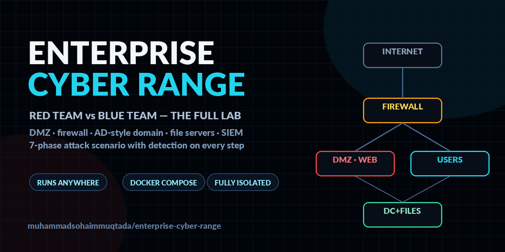
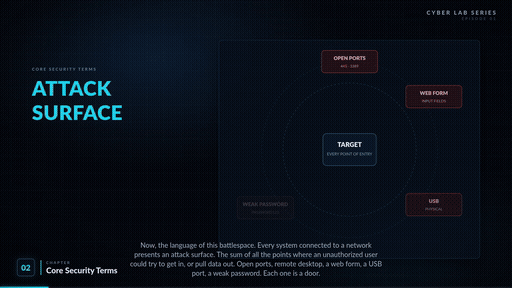

# Enterprise Cyber Range — Red Team vs Blue Team

<p align="center">
  
</p>

<h3 align="center">A complete, self-contained enterprise network — and a full attack scenario run against it.</h3>

---

## 🎬 Watch the walkthrough

<p align="center">
  <a href="https://github.com/muhammadsohaimmuqtada/enterprise-cyber-range/releases/download/v1.0/Cybersecurity-Terms-RedTeam-Lab-Explained.mp4">
    
  </a>
</p>

<p align="center">
  <b>▶ <a href="https://github.com/muhammadsohaimmuqtada/enterprise-cyber-range/releases/download/v1.0/Cybersecurity-Terms-RedTeam-Lab-Explained.mp4">Watch the full 20-minute video — Cybersecurity Terms &amp; Concepts Explained (1080p)</a></b><br>
  <sub>The teaser above loops automatically; GitHub does not allow autoplaying video in READMEs, so the full film lives on the Releases page.</sub>
</p>

Every concept the video teaches — the kill chain, DMZ and VLAN segmentation, stateful firewall rules with an implicit deny, an AD-style domain controller, SMB file servers, a SIEM, dwell time, IOC vs IoA — exists in this repository as a **working, attackable system**.

## What is this?

A miniature enterprise, built from nine containers, plus an attacker workstation and a seven-phase intrusion scenario executed against it — with the blue team's view (logs, firewall counters, audit trails, SIEM alerts) documented for every phase.

| Segment | Subnet | Hosts |
|---|---|---|
| External (attacker) | `172.31.100.0/24` | `attacker` (Kali), `internet` |
| DMZ | `10.10.10.0/24` | `web01` — nginx + intranet portal |
| Users | `10.10.20.0/24` | `ws1`, `ws2` — domain-joined workstations |
| Servers | `10.10.30.0/24` | `dc01` (Samba AD DC), `filesrv` (SMB + `critical` share), `siem` (Wazuh, optional profile) |

A single `fw` container routes between all four segments and enforces the video's exact firewall doctrine: stateful inspection, a named allow-list (including the "this one workstation may speak file sharing to this one server" rule), egress filtering, per-rule counters, and a final **implicit deny**.

```
                        ┌────────────────────┐
   attacker (Kali) ─────►  INTERNET / EDGE  │
                        └─────────┬──────────┘
                             ┌────▼─────┐
                             │    fw    │  nftables · stateful · egress filter
                             └─┬──┬──┬──┘
              ┌────────────────┘  │  └───────────────┐
        ┌─────▼─────┐      ┌──────▼──────┐    ┌──────▼───────────────┐
        │ DMZ       │      │ USERS       │    │ SERVERS              │
        │ web01     │      │ ws1 · ws2   │    │ dc01 · filesrv · siem│
        └───────────┘      └─────────────┘    └──────────────────────┘
```

## 🚀 Quickstart

**Requirements:** any environment with Docker Engine ≥ 24 and Docker Compose v2, x86_64, ~6 GB free RAM (+4 GB if you enable the SIEM profile). Your laptop, a home server, a VM, a cloud instance — the range is fully self-contained and runs identically everywhere; it never touches the host network beyond Docker itself.

```bash
git clone https://github.com/muhammadsohaimmuqtada/enterprise-cyber-range.git
cd enterprise-cyber-range
cp .env.example .env
make up          # build and start the full range
make status      # service health + live firewall counters
```

Then open [`scenario/PHASE-0-setup.md`](scenario/PHASE-0-setup.md) and begin.

Optional blue-team stack (adds the Wazuh SIEM, ~4 GB RAM): `make blue`.

**No Docker on the machine in front of you?** Any throwaway Linux VM works — and a GitHub Codespace on this repo is preconfigured as one (docker-in-docker included), so it doubles as an isolated test bench. The lab itself neither knows nor cares where it runs.

> Reference configuration, validated with `docker compose config` and reviewed end-to-end, but not pre-run on every platform. If a service misbehaves on your first boot, open an issue with the output of `make status`.

## ⚔️ The scenario — seven phases, both sides of the board

Each phase is a self-contained playbook: the attacker's exact commands, what the firewall and services log, which detection fires, the IOC/IoA distinction, and the kill-chain position.

| Phase | Video chapter | File |
|---|---|---|
| 0 — Setup, ground rules, snapshots | Ch. 1 | [`scenario/PHASE-0-setup.md`](scenario/PHASE-0-setup.md) |
| 1 — Remote entry (reconnaissance of the perimeter) | Ch. 7, phase 1 | [`scenario/PHASE-1-remote-entry.md`](scenario/PHASE-1-remote-entry.md) |
| 2 — Initial foothold (simulated web weakness) | Ch. 7, phase 2 | [`scenario/PHASE-2-initial-foothold.md`](scenario/PHASE-2-initial-foothold.md) |
| 3 — Execution & discovery | Ch. 7, phase 3 | [`scenario/PHASE-3-execution-discovery.md`](scenario/PHASE-3-execution-discovery.md) |
| 4 — Lateral movement (DMZ → file server, east-west) | Ch. 7, phase 3–4 | [`scenario/PHASE-4-lateral-movement.md`](scenario/PHASE-4-lateral-movement.md) |
| 5 — Privilege escalation & the `critical` share | Ch. 7, phase 5 | [`scenario/PHASE-5-privilege-critical-access.md`](scenario/PHASE-5-privilege-critical-access.md) |
| 6 — Exfiltration (through the egress filter) | Ch. 7, phase 5 | [`scenario/PHASE-6-exfiltration.md`](scenario/PHASE-6-exfiltration.md) |
| 7 — Persistence & covering tracks | Ch. 7, phase 6–7 | [`scenario/PHASE-7-persistence-covering-tracks.md`](scenario/PHASE-7-persistence-covering-tracks.md) |

## 🛡️ Blue team

- [`detections/fw-baseline.md`](detections/fw-baseline.md) — the full rule base as a table, rule by rule, mapped to the video
- [`detections/audit-policy.md`](detections/audit-policy.md) — Samba full-audit + auditd: the Event-4663 analog
- [`detections/soc-runbook.md`](detections/soc-runbook.md) — alert → log source → first three investigation commands → containment
- [`detections/ioc-ioa-worksheet.md`](detections/ioc-ioa-worksheet.md) — fill it in as you run the scenario
- [`siem/`](siem/) — Wazuh rules for edge denies, lateral movement, critical-share reads, and exfil attempts

Purple-team mode: run each phase twice — once as red, once reading only the logs as blue. That is the entire point of the exercise.

## 📚 Docs

- [`docs/architecture.md`](docs/architecture.md) — segment design, north-south vs east-west, where IDS/IPS/NAC/jump-host/NGFW would slot in
- [`docs/ips-vlans.md`](docs/ips-vlans.md) — full IP plan
- [`docs/video-mapping.md`](docs/video-mapping.md) — every chapter of the video → the exact artifact that demonstrates it
- [`fw/README.md`](fw/README.md) — the five firewall types and where this implementation sits
- [`policies/password-policy.md`](policies/password-policy.md) — the GPO-analog domain password policy

## ⚠️ Authorized lab use only

Everything here runs on isolated Docker networks. No host networks are touched, all data is fake, and the only "vulnerability" is an opt-in flag (`WEAK_AUTH=1`) that exists so the scenario can be studied from both sides. See [`DISCLAIMER.md`](DISCLAIMER.md). The three ground rules from the video apply: isolated network only, authorization required (in a home lab, that signature is your own), and the goal is defensive.

## License

MIT — see [LICENSE](LICENSE).
